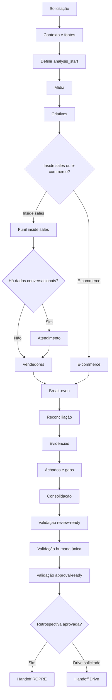

# Leia-me: orquestração da retrospectiva de performance

## 1. Objetivo do kit

Este kit transforma fontes dispersas em uma retrospectiva auditável. Ele preserva dados brutos, regras de normalização, cobertura, conflitos e evidências para separar fatos, hipóteses e lacunas.

A retrospectiva descreve o passado. Ela não define prioridade, responsável ou prazo. Depois da aprovação, o adaptador `account-ropre-quarter-retrospectiva` entrega os insumos ao ROPRE Quarter, que cuida do planejamento.

## 2. Componentes

### Orquestrador

- `account-retrospectiva-performance-maestro`: identifica contexto, escolhe o ramo aplicável, executa os módulos na ordem correta e controla os gates de validação.

### Descoberta e aquisição

- `account-retrospectiva-contexto-fontes`: define cliente, período, modelo de negócio, janela válida e manifesto de fontes.
- `account-retrospectiva-midia`: reconstrói investimento e performance nas granularidades disponíveis.
- `account-retrospectiva-criativos`: analisa mensagens, formatos e assets, vinculando-os aos resultados de mídia e funil.

### Ramo de inside sales

- `account-retrospectiva-funil-inside-sales`: reconstrói o funil lead a lead e aplica as definições validadas de MQL, SQL, oportunidade e venda.
- `account-retrospectiva-atendimento`: audita conversas, SLA, conexão, pendências e follow-ups quando existem dados conversacionais.
- `account-retrospectiva-vendedores`: compara execução, competência comercial e resultado sem misturar essas três dimensões.

### Ramo de e-commerce

- `account-retrospectiva-ecommerce`: cruza mídia, GA4, pedidos, receita, produtos, margem, estoque, cancelamentos e reembolsos.

O ramo de e-commerce substitui o ramo de inside sales. A escolha é feita a partir das evidências do contexto do cliente.

### Fechamento analítico

- `account-retrospectiva-breakeven`: localiza ou calcula as referências econômicas usadas para julgar performance.
- `account-retrospectiva-reconciliacao`: resolve identidades e atribuição entre mídia, CRM, conversas, GA4 e loja.
- `account-retrospectiva-evidencias`: cria o ledger que liga cada conclusão à sua fonte e regra de cálculo.
- `account-retrospectiva-achados-gaps`: consolida vencedores, perdedores, padrões, hipóteses e lacunas.
- `account-retrospectiva-consolidacao`: monta o documento final e o índice do pacote.
- `account-retrospectiva-drive-handoff`: prepara a publicação versionada no Drive, somente quando solicitada e autorizada.
- `account-ropre-quarter-retrospectiva`: converte a retrospectiva aprovada em handoff para o planejamento do próximo quarter.

## 3. Sequência de execução



### Ordem canônica

1. Contexto e fontes.
2. Mídia.
3. Criativos.
4. Ramo de inside sales ou e-commerce.
5. Break-even.
6. Reconciliação.
7. Evidências.
8. Achados e gaps.
9. Consolidação.
10. Validação humana.
11. Handoff para ROPRE e, se autorizado, para Drive.

## 4. Janela de análise

Quarter calendário e janela de performance não são sinônimos. Antes de julgar resultados, o fluxo identifica:

- início e fim do período solicitado;
- go-live técnico;
- primeiro evento real;
- testes e dados pré-operacionais;
- mudanças estruturais ou relançamentos;
- `analysis_start`, a data a partir da qual a performance é considerada válida.

Os dados anteriores continuam no contexto, mas não diluem a análise pós-go-live.

## 5. Contrato de dados e evidências

Cada módulo deve preservar:

- valor bruto e valor normalizado;
- fonte, período e data de extração;
- regra de match ou cálculo;
- cobertura e confiança;
- conflitos, ambiguidades e itens não atribuídos.

Ausência de dado não vira zero. Conflito não é ocultado. Correlação não é apresentada como causa sem prova.

## 6. Granularidade de mídia

Quando existe mídia paga, o kit tenta cobrir todas as dimensões aplicáveis:

- geral;
- canal;
- rede ou subcanal;
- estratégia;
- destino;
- campanha;
- conjunto ou ad group;
- anúncio;
- criativo;
- público ou keyword;
- região;
- gênero;
- idade;
- dispositivo;
- posicionamento.

As tabelas incluem vencedores, intermediários, perdedores, entidades com zero resultado, não atribuídos e amostras insuficientes. Rankings resumidos não substituem as bases integrais.

## 7. Gates de qualidade

### Review-ready

Antes de apresentar o pacote, o validador confirma que:

- `decisoes.md` existe e segue o contrato;
- todo módulo parcial ou bloqueado possui uma lacuna registrada;
- toda dimensão de mídia parcial ou indisponível está explicitada;
- os artefatos obrigatórios estão presentes.

Comando de referência:

```text
validate_retrospectiva.py <run_dir> --review-ready
```

### Approval-ready

Depois da validação humana, o segundo gate bloqueia:

- decisões ainda marcadas como assumidas;
- lacunas abertas;
- módulos parciais sem aceite nominal.

Comando de referência:

```text
validate_retrospectiva.py <run_dir> --approval-ready
```

Somente depois desse gate o comando `retrospectiva aprovada` libera o handoff para o ROPRE.

## 8. Artefatos produzidos

Uma execução é versionada em:

```text
checkins/quarter/{ano}/Q{n}/retrospectiva-performance/{run_id}/
```

O pacote pode conter:

| Ordem | Artefato | Responsabilidade |
|---:|---|---|
| 00 | `00-manifesto-fontes.md` | Fontes, cobertura e conflitos |
| 01 | `01-contexto-cliente.md` | Contexto e janela válida |
| 02 | `02-midia.md` | Performance de mídia |
| 03 | `03-criativos.md` | Análise de criativos |
| 04 | `04-funil-inside-sales.md` ou `04-ecommerce.md` | Ramo do modelo de negócio |
| 05 | `05-vendedores.md` | Comparação comercial |
| 06 | `06-atendimento.md` | Auditoria conversacional |
| 07 | `07-breakeven.md` | Referências econômicas |
| 08 | `08-reconciliacao.md` | Identidade e atribuição |
| 09 | `09-evidencias.md` | Ledger de evidências |
| 10 | `10-achados-gaps.md` | Achados, hipóteses e lacunas |
| 11 | `11-retrospectiva-final.md` | Consolidação final |
| 12 | `12-handoff-ropre.md` | Entrada para o ROPRE |
| 13 | `13-drive-handoff.md` | Plano de publicação no Drive |
| — | `decisoes.md` | Decisões e validação humana |

## 9. Reexecução e versionamento

Uma correção humana nunca sobrescreve a execução anterior. O fluxo cria uma nova `run_id`, registra a `parent_run_id` e recalcula a partir do primeiro módulo afetado. Isso preserva a trilha de auditoria.

## 10. Limites operacionais

O kit não:

- cria tarefas ou planos de ação;
- define responsáveis, prioridades ou prazos;
- altera CRM, campanhas ou etapas;
- escreve no Drive sem autorização explícita;
- inventa definições de MQL, SQL, venda, margem ou meta;
- oculta lacunas para produzir uma conclusão mais limpa.

Esses limites mantêm a retrospectiva separada do planejamento e garantem que o ROPRE comece com uma base verificável.
