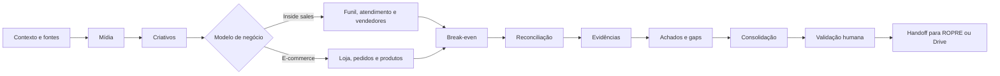

# Kit de Retrospectiva de Performance

Kit de skills para executar retrospectivas trimestrais auditáveis de operações de inside sales e e-commerce. A skill `account-retrospectiva-performance-maestro` coordena a descoberta de fontes, as análises especializadas, a reconciliação dos dados e a consolidação final.

Este é um repositório independente e pronto para instalação. Ele contém 14 skills de retrospectiva e o adaptador `account-ropre-quarter-retrospectiva`, espelhados para Claude, Agents e Codex.

O fluxo responde a quatro perguntas:

1. O que aconteceu no período?
2. O que funcionou e o que falhou?
3. Quais conclusões possuem evidência rastreável?
4. Quais lacunas precisam ser aceitas ou resolvidas antes do planejamento?

## Visão rápida



## Skill de entrada

Use `account-retrospectiva-performance-maestro` quando precisar analisar um período de performance, comparar projetado versus realizado ou preparar insumos comprovados para um ROPRE Quarter.

Exemplo de solicitação:

> Execute a retrospectiva de performance do cliente no período informado, em modo autônomo, e apresente o pacote final para validação.

O modo padrão é autônomo: o fluxo percorre todos os módulos disponíveis, registra decisões e concentra a validação humana no final.

## Estrutura do repositório

```text
.
├── .agents/skills/   # Espelho para agentes compatíveis
├── .claude/skills/   # Espelho para Claude Code
├── .codex/skills/    # Espelho para Codex
├── README.md         # Visão geral
└── LEIA-ME.md        # Orquestração detalhada
```

## Instalação

Clone o repositório e copie a árvore compatível com o seu agente para a raiz do seu workspace. Para manter compatibilidade entre ferramentas, copie as três árvores.

```bash
git clone https://github.com/junioraiellogestaodetrafego-maker/account-retrospectiva-performance-kit.git
```

Depois da instalação, acione `account-retrospectiva-performance-maestro`; os demais módulos são chamados por ela conforme o modelo de negócio e a disponibilidade das fontes.

## Compatibilidade

O kit é publicado de forma espelhada em:

- `.claude/skills/`
- `.agents/skills/`
- `.codex/skills/`

As três árvores devem permanecer idênticas. O Hub cataloga a cópia em `.claude`, exige o espelho em `.agents` e o pacote mantém `.codex` para uso direto no Codex.

## Documentação completa

Consulte [LEIA-ME.md](./LEIA-ME.md) para entender a ordem dos módulos, as ramificações por modelo de negócio, os gates de qualidade e os artefatos produzidos.
